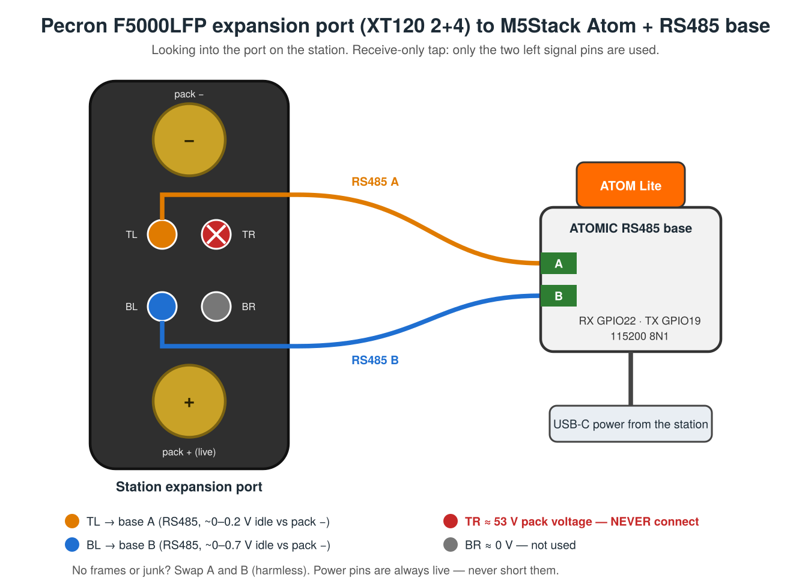

# Pecron F5000LFP expansion-bus monitor (ESPHome, M5Stack Atom)

Read the **internal BMS of a Pecron F5000LFP** — all 16 cell voltages, pack voltage and
current, SOC, 11 temperatures and BMS firmware — by listening to the station's
expansion-battery port with an **M5Stack Atom + ATOMIC RS485 base** running ESPHome.

The data appears in Home Assistant every ~3 seconds, fully local. Neither the Pecron app nor
the cloud shows per-cell voltages.

## What it does

The F5000's head unit talks to its BMS (and to any expansion packs) over RS485 on the
expansion port. This firmware **only listens**: it never transmits. The TX pin is configured
solely to hold the RS485 base's auto-direction circuit in receive mode.

| Sensor | Notes |
|---|---|
| Cell 01–16 (mV) | Plus min, max, differential, lowest/highest cell number |
| Pack voltage (V), current (A), power (W) | Current sign: + charging, − discharging |
| SOC (%) | As reported by the BMS |
| Temp 01–11 (°C) and Temp max | Page 04's first three temperatures repeat page 03's, so 11 are unique |
| Current 2 (A) | Second current measurement, purpose unconfirmed (see notes) |
| Charging (binary) | BMS charging flag |
| Model, device key, BMS firmware | From the bus (e.g. `F5000LFP`, `1.0.3`) |
| Unknown P3[42], [43], [49] | Diagnostic, kept for decoding |
| Bus valid messages / junk bytes | Bus-health counters |

A **Log Raw Frames** switch prints every frame as hex for anyone decoding further.

## Hardware

- M5Stack **ATOM Lite** (or Atom Matrix / Atom S3 with matching pins)
- M5Stack **ATOMIC RS485 base**
- A plug for the station's **XT120 2+4** expansion port (only the two RS485 signal pins are
  used), or careful probe wiring
- USB-C power — the station's own USB or DC output works

## Wiring

Looking into the expansion port on the station:

| Port pin | Measured | Connect to |
|---|---|---|
| Signal top-left (TL) | RS485, ~0–0.2 V idle | RS485 base **A** |
| Signal bottom-left (BL) | RS485, ~0–0.7 V idle | RS485 base **B** |
| Signal top-right (TR) | **≈ 53 V pack voltage** | **Nothing — never connect** |
| Signal bottom-right (BR) | ≈ 0 V | Not used |
| Large pin above the signal block | Pack − | Not used |
| Large pin below the signal block | Pack + (always live) | Not used |

- **A/B polarity:** RS485 A/B labelling varies between vendors. If you see no valid frames
  or rising junk bytes, swap A and B — it is harmless.
- **Ground:** none is needed when the Atom is powered from the same station. If you power the
  Atom from elsewhere, you may need a common reference; test carefully.
- ⚠️ The power pins are **always live** (not switched by the station) and the top-right
  signal pin carries pack voltage. A short here can damage the station or the Atom.

## Install

1. Copy `pecron-f5000-bus.yaml` into your ESPHome folder.
2. Add these to `secrets.yaml`: `wifi_ssid`, `wifi_password`, `ota_password`,
   `api_encryption_key` (generate one with `openssl rand -base64 32`).
3. Optionally change `device_name` at the top.
4. Flash the Atom (USB the first time, then wirelessly).
5. Home Assistant discovers it via the ESPHome integration.

## Protocol summary

Full byte-level notes: [docs/protocol.md](docs/protocol.md).

- **Bus:** RS485, 115200 8N1, Modbus-RTU framing with CRC-16/Modbus.
- **Poll:** the head unit sends `<addr> 03 8202 0032 <crc>` to slots `00`–`05` (expansion
  packs) and `FF` (internal BMS), one every ~200 ms, full cycle ~3 s.
- **Reply:** only `FF` answers, with 50 data bytes. It alternates between two pages:
  **03** (cells, pack, current, SOC) and **04** (firmware, temperatures, second current).
- **Identity broadcast:** `FE 10 0000 0011 22 …` carries the model and the station's
  device key (its Wi-Fi MAC).

## Known limits / open questions

- The BMS exposes **status only**. A read-only probe sweep found no settings pages: it answers
  only register numbers ending in `02` with length `0x32`, and always with the same two pages.
- Unknown fields: page 03 bytes 42 and 43 (constant 19 / 36 so far) and byte 49 (slowly
  increments at rest — possibly a rest or state counter).
- **Current 2** reads about two thirds of the pack current at idle; possibly an
  auxiliary/DC branch. Unconfirmed.
- No expansion pack has been captured yet. If you own one, a raw log with it connected
  would be very welcome — open an issue.

## Related

- Home Assistant integration for Pecron stations (Bluetooth / Wi-Fi / cloud):
  [aogden24-byte/ha-pecron](https://github.com/aogden24-byte/ha-pecron)

## Licence

MIT © Andrew Ogden. Not affiliated with Pecron. Use at your own risk.
